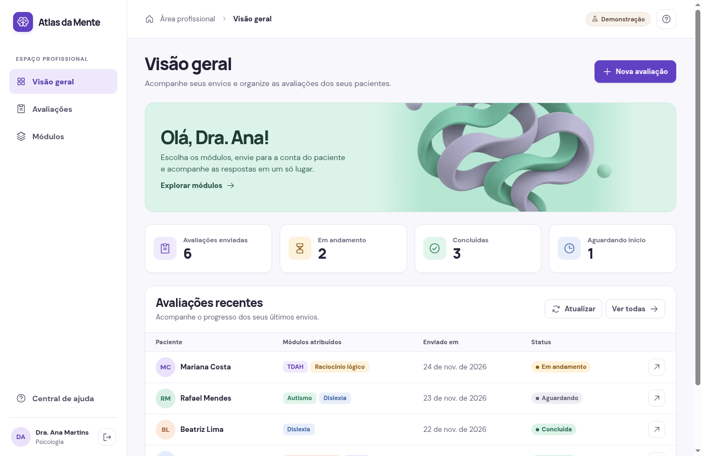
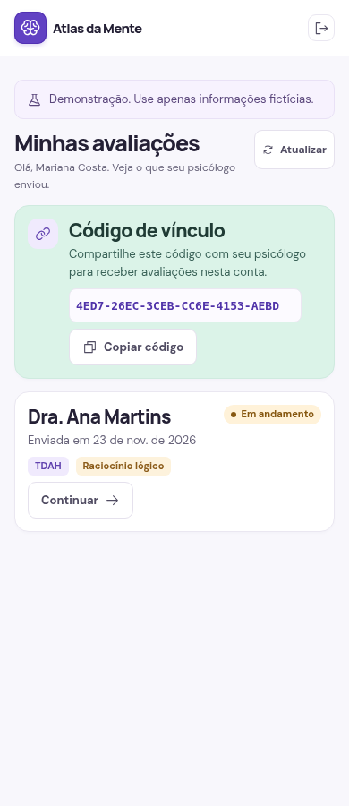
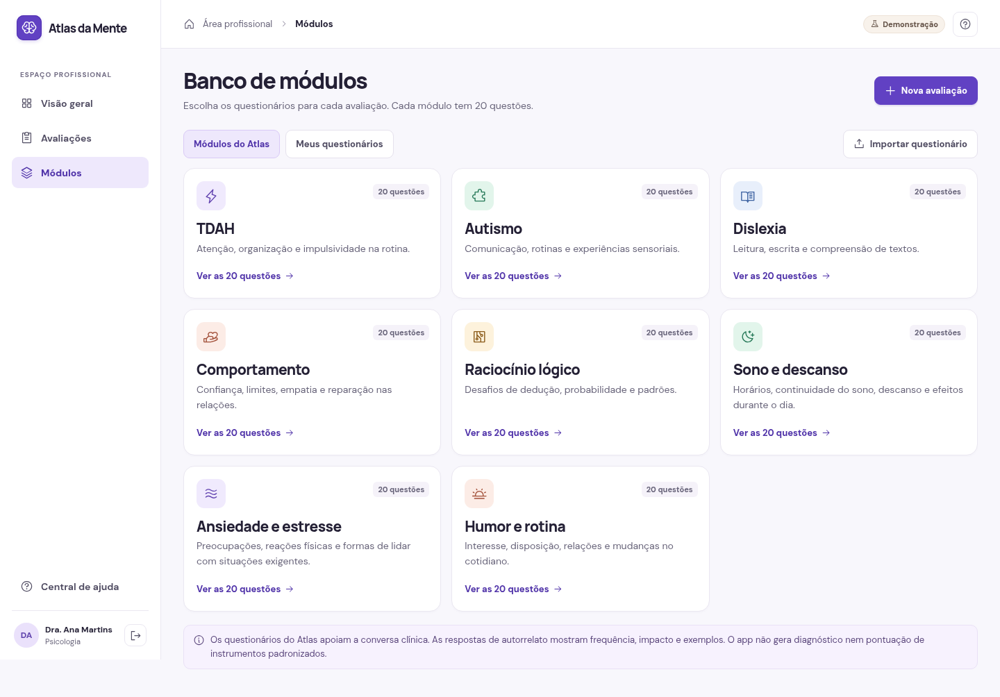
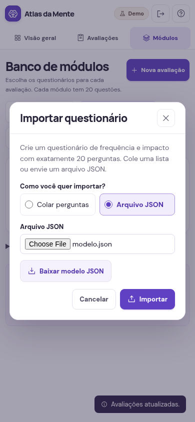

# Atlas da Mente

**Versão de teste, 0.0.0.** O Atlas da Mente funciona no computador (Windows e Linux), no Android e pelo navegador. O psicólogo monta e envia uma avaliação. O paciente responde na própria conta e pode retomar o progresso. Após a conclusão, ambos podem consultar o resumo. Use dados fictícios nesta versão.

## Aplicativos

| Plataforma | Como abrir |
| --- | --- |
| **Windows x64** | Extraia todo o ZIP e abra `Atlas-da-Mente.exe`. O pacote de teste usa distribuição portátil. |
| **Linux x64** | Extraia o ZIP e execute `Atlas-da-Mente` dentro da pasta extraída. Use uma sessão gráfica. |
| **Android 8 ou superior** | Instale o APK de teste e informe o endereço do servidor na primeira tela. |

No computador, o aplicativo abre uma demonstração local com SQLite. Para trabalhar com as mesmas contas nos dois aparelhos, escolha **Atlas da Mente → Servidor** no computador e **Menu → Servidor** no Android. Informe o mesmo endereço HTTPS de uma instância do Atlas nos dois. A demonstração interna do computador é acessível apenas naquele aparelho.

### Testar o Android com um servidor local

Em um computador na mesma rede Wi-Fi do celular, execute a versão web pela seção abaixo. No Android, informe `http://IP_DO_COMPUTADOR:3000` usando o endereço IPv4 da rede local. No emulador oficial do Android, use `http://10.0.2.2:3000`. A conexão HTTP na rede local é exclusiva para a demonstração com dados fictícios. Se o firewall bloquear a conexão, permita a porta 3000 na rede local de teste.

Os pacotes desta versão usam distribuição de teste. O Windows pode pedir confirmação ao abrir o executável, e o Android pode pedir permissão para instalar o APK pelo aplicativo de arquivos. A assinatura do APK é de teste. Uma instalação assinada por outra chave pode precisar ser removida antes de instalar este APK.

## Rodar pelo navegador

Requer Node.js 24 ou superior e Git.

```sh
git clone https://github.com/NyxPjct/Atlas-da-Mente-.git
cd Atlas-da-Mente-
npm ci
npm start
```

Abra [localhost:3000](http://localhost:3000). Os botões **Psicólogo demo** e **Paciente demo** abrem os perfis fictícios sem senha. Para simular contas diferentes, também é possível usar **Criar conta** com endereços fictícios distintos. Os dados ficam no SQLite local em `data/demo.sqlite`.

## Fluxo da avaliação

1. Entre como **Paciente demo** e copie o **Código de vínculo** em **Minhas avaliações**.
2. Saia, entre como **Psicólogo demo** e abra **Nova avaliação**. Cole o código, escolha os módulos e envie. Uma orientação ao paciente é opcional.
3. Volte à conta de paciente, abra o envio e responda ou pule as questões. O progresso é salvo conforme você avança.
4. Depois de concluir, abra o resumo. No painel do psicólogo, selecione **Atualizar** e abra a avaliação para ver respostas por tema e imprimir o relatório. Use **Desativar acesso** para retirar o envio da área do paciente e bloquear o link direto.

Para usar os dois perfis ao mesmo tempo, abra o app em uma janela comum e outra privativa.

## Módulos e resultados

O banco tem 160 questões autorais, divididas em oito módulos de 20 questões.

- **TDAH** aborda atenção, organização e impulsividade.
- **Autismo** aborda comunicação, rotina e experiências sensoriais.
- **Dislexia** aborda leitura, escrita e compreensão de textos.
- **Comportamento** aborda confiança, limites, empatia e reparação nas relações.
- **Raciocínio lógico** apresenta desafios com gabarito comentado.
- **Sono e descanso** aborda horários, continuidade do sono e funcionamento durante o dia.
- **Ansiedade e estresse** aborda preocupações, reações físicas e estratégias para lidar com demandas.
- **Humor e rotina** aborda interesse, energia, relações e mudanças no cotidiano.

Nos módulos de autorrelato, o resumo mostra a frequência e o impacto informado pelo paciente. O percentual usa apenas as situações respondidas, e os exemplos ficam disponíveis para revisão. Em raciocínio lógico, o resumo apresenta a contagem de acertos e a solução de cada desafio. O material autoral tem finalidade educativa e de apoio à conversa clínica. Os questionários carecem de validação psicométrica e os resultados não fornecem diagnóstico ou estimativa de QI.

## Questionários próprios

Abra **Módulos → Importar questionário**. Cole 20 perguntas de autorrelato, uma por linha. O formato `Tema | Pergunta` permite agrupar o resumo. Também é possível importar um arquivo JSON com os campos `title`, `description` (opcional), `period` (opcional) e `questions` (lista de 20 objetos com `prompt` e `theme` opcional). Um modelo está disponível no formulário.

Em **Meus questionários**, abra o módulo para revisar, exportar em JSON, arquivar ou reativar. Cada importação guarda uma versão independente. Arquivar tira o questionário dos novos envios. Avaliações que já o usam continuam disponíveis. Os questionários importados usam a escala de frequência e impacto do Atlas. A interpretação profissional e as condições de uso do material importado devem ser verificadas pelo autor do envio.

## Capturas da demonstração

| Painel profissional no computador | Conta do paciente no celular |
| --- | --- |
|  |  |
| **Banco de módulos** | **Importação de questionários** |
|  |  |

## Desenvolvimento e testes

- `npm run dev` reinicia o servidor quando o código do backend muda.
- `npm test` verifica o catálogo, o isolamento entre contas, o progresso, a migração de versões anteriores e os questionários importados.

O frontend usa HTML, CSS e JavaScript. O servidor usa Node.js e SQLite. O computador usa Electron, e o Android usa a WebView do sistema. O Git ignora bancos locais, dependências, saídas de compilação e o arquivo `.env`.

### Empacotar para computador

```sh
npm ci
npm run desktop
npm run desktop:build -- win32
npm run desktop:build -- linux
```

Os pacotes x64 saem em `dist/desktop`. Use o pacote correspondente ao sistema de destino.

### Compilar o APK de teste

Instale o JDK 17 ou superior e o SDK do Android com **Android SDK Platform 35** e **Build Tools 35.0.1**. Aponte a variável `ANDROID_HOME` para seu SDK e rode `npm run android:build`. O APK assinado sai em `dist/android/Atlas-da-Mente-0.0.0-teste.apk`. A chave de teste fica no diretório de saída.

## Instância com contas privadas

Defina `NODE_ENV=production` e exponha o app via HTTPS. A aplicação usa um banco SQLite privado que deve ficar em um volume persistente. Em produção, o login de demonstração fica indisponível, e cada usuário cria sua conta com e-mail e senha. A seleção do perfil no cadastro determina a área de acesso. Ela não verifica identidade, posse do e-mail ou inscrição no conselho profissional. A aplicação não envia e-mails de confirmação ou recuperação de senha.

| Variável | Função |
| --- | --- |
| `ATLAS_DB` | Caminho do banco. O padrão em produção é `data/atlas.sqlite` |
| `ATLAS_DEMO` | Use `0` para testar sem os perfis fictícios fora de produção |
| `PORT` | Porta HTTP do processo. O padrão é 3000 |
| `HOST` | Endereço de escuta. O padrão é `0.0.0.0` |

O código de vínculo identifica a conta que receberá uma avaliação. Ele não dá acesso à conta ou às respostas. O link direto exige que o paciente entre na conta vinculada. Antes de usar com dados reais, valide os requisitos de privacidade, consentimento, retenção e segurança da sua prática.

### Avaliações da versão anterior

Para um banco privado já existente, configure `ATLAS_LEGACY_EMAIL` com o e-mail que será usado pelo profissional da instância e forneça o valor anterior de `ATLAS_PASSWORD` pelo gerenciador de segredos. No primeiro início com esses valores, as avaliações anteriores passam para essa conta profissional. Se ainda não houver uma conta com o e-mail, ela será criada com a senha anterior. Depois de confirmar a migração, remova essas duas variáveis. Se elas forem omitidas antes da migração, os registros ficam preservados sem aparecer nas novas contas. Abra cada registro no painel e confirme a identidade do paciente antes de usar **Vincular conta**.
